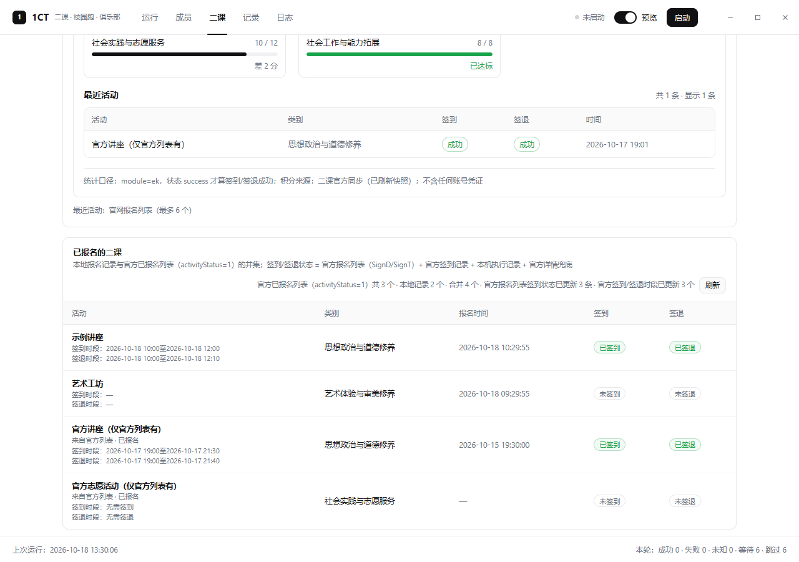

# 1CT · 二课 / 校园跑 / 俱乐部 桌面自动化

1CT 是 **3CT 1.2.5** 的独立桌面副本：复用原程序的 `window.ctAPI`，替换渲染层为极简界面，并加入多成员、二课积分缺口同步、已报名二课、签到/签退跟踪、校园跑随机参数等自动化能力。

> 本仓库只包含源码与文档；**不包含**原版 3CT 程序、Electron 二进制、打包产物或任何账号数据。构建时需要本机已安装 3CT 1.2.5。



## 功能

- 多成员：同一台电脑为多人分别处理二课 / 校园跑 / 俱乐部，成员独立存储、独立登录态。
- 二课：
  - 八模块缺口自动从学校官方接口同步（无需手填）
  - 已报名二课列表直连官网（`activityStatus=1`，自动分页），本地无历史也不会清零
  - 签到/签退状态读取官网「报名/完成列表」同源接口（`GetStuAllActApplyList` 的 `SignD`/`SignT`），活动详情兜底
  - 每行显示官方**签到时段 / 签退时段**（两行完整显示），方便安排挂机时间
  - 「最近活动」显示官网最近 6 个签到/签退成功记录
  - 已报名活动自动跟踪签到/签退（不受关键词限制）；会话过期自动续期/重登一次
  - 无可用二维码时走官方 `StuSaveSignIn` 无码直签兜底（可用 `ek.noQrFallback=false` 关闭）
- 校园跑：窗口、里程、时长每天自动随机，按日去重，不需要每天手填。
- 俱乐部：按关键词报名，在每日上限内自动报名并签到/签退。
- 结果看板 / 记录 / 日志 / CSV 导出；预览模式默认开启，真实提交需显式关闭预览。

## 目录结构

```text
desktop/
  automation.js       二课/校园跑/俱乐部自动化引擎
  panel.js            3CT-Auto 悬浮面板
  dashboard.js        结果看板
  result-store.js     本地执行历史
  score-policy.js     八模块缺口策略
  install.py          3CT-Auto 副本构建
  install_1ct.py      1CT 副本构建（ASAR 补丁 / 1CT 资源注入）
  1ct/                1CT 渲染层（shell/members/ek-stats）与打包文档
  vendor/jsQR.js      二维码解码（第三方，MIT）
auto3ct/              Python 调度/预览辅助模块
tests/                Python + Node 测试与冒烟
reverse/              ASAR 解包 / sourcemap 提取工具
docs/                 使用说明、升级指南、设计契约
```

## 构建

前置条件：

- Windows 10/11
- 本机已安装 **3CT 1.2.5**，默认位于仓库同级的 `3CT/` 目录（可用 `--source` 覆盖）
- Python 3.11+
- Node.js 20+（仅运行 JS 测试需要）
- PowerShell

构建 3CT-Auto：

```powershell
python desktop/install.py build
python desktop/build_gui_launcher.py
```

构建 1CT：

```powershell
python desktop/install_1ct.py build --force
python desktop/install_1ct.py verify
```

产物会生成在 `1CT/` 与仓库根目录的 `启动1CT.exe`（已被 `.gitignore` 忽略，不提交）。

## 测试

```powershell
python -m unittest discover -s tests -v
node --test desktop/test-automation.cjs
node --test desktop/test-automation-score.cjs
node desktop/test-1ct-shell.cjs
```

浏览器/打包测试使用 Playwright（`PLAYWRIGHT_CORE` 可指定安装路径），不会用真实账号向学校平台提交写请求。

## 用户数据

1CT 使用独立目录 `%APPDATA%\1CT` 保存成员、登录态、配置与执行历史；升级只替换程序目录，不影响用户数据。**分发包不含账号、密码、会话或历史数据**，首次启动需要自行登录。

## 第三方

- `desktop/vendor/jsQR.js`：jsQR，MIT License（见 `jsQR.LICENSE.txt`）。
- 原版 3CT 及其 Electron 运行时不随本仓库分发。
